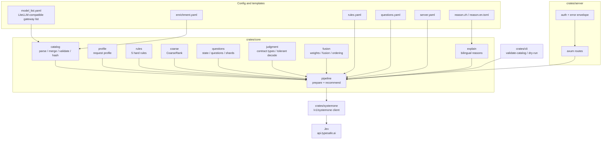
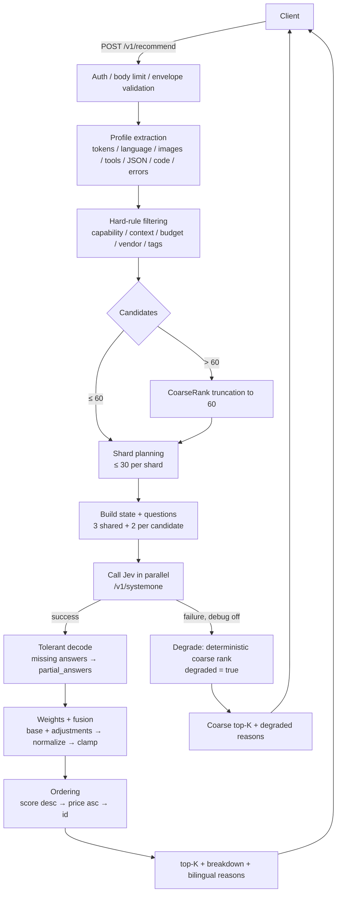
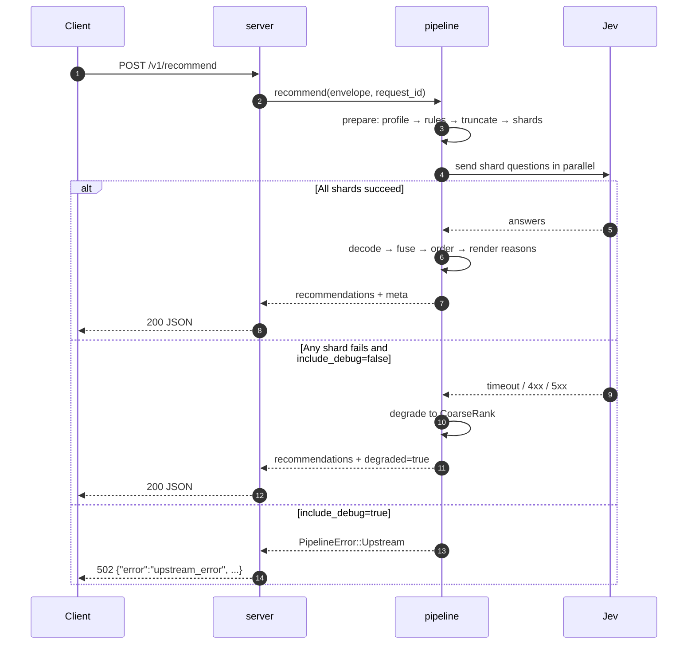

[简体中文](README.md) | **English** | [繁體中文](README.zh-TW.md)

# intelligent-model-router (model recommender)

Takes a raw gateway request body (OpenAI / Claude style, the `request` field of the POST body) and returns top-K model recommendations with templated Chinese/English reasons.
Three layers: deterministic hard-rule filtering + TypeSafe System One (Jev) semantic judgment + code-based weighted fusion.

- Standalone HTTP service: recommendations only — it never forwards requests or calls models on your behalf;
- The catalog reuses the gateway's LiteLLM `model_list` file (read at startup; prices follow the file — restart to pick up changes). Recommendation metadata (capabilities / context / tags) comes from `enrichment.yaml`, with defaults for unlisted models;
- When the backend is unavailable it degrades to deterministic coarse ranking (`degraded: true`) and still answers;
- Reasons are template-rendered (zh/en) with no extra LLM calls.

## Architecture and request flow

### Modules and data flow



### A recommendation request



### Call sequence



### Layers

1. **Catalog assembly (startup)**: `catalog.model_list_path` + `catalog.enrichment_path` → parse the LiteLLM `model_list`, enrich field by field from `enrichment.yaml`; duplicate `model_name` entries are merged (first price wins); non-chat / disabled / unpriced entries go to `skipped`; the first 16 hex chars of the content hash become `catalog_version`.
2. **Profile**: extract estimated tokens, CJK ratio (zh/other), images, tools count, JSON mode, streaming, `max_tokens`, code-block/error/link hints, and a cleaned excerpt (first 2000 / last 500 chars).
3. **Hard rules**: capability (tools/vision/json_mode), context (`ceil(est×safety)+max_tokens ≤ context_window`), budget, vendor allow/deny, `require_tags`; the first matching filter removes the candidate.
4. **Truncation and sharding**: with more than 60 candidates, truncate by CoarseRank first; each shard holds ≤ 30 candidates and renumbers its question IDs as `c0…`, then maps answers back to global indices.
5. **Semantic judgment**: shared questions `task_type` / `difficulty` / `frontier_needed` + per-candidate `quality_fit` / `cost_fit`; parallel calls to `/v1/systemone` (the model is pinned by backend config, e.g. `jev-1.13.0`).
6. **Tolerant decoding**: missing or mistyped answers are listed in `meta.partial_answers`; a missing dimension contributes normalized 0.5 with confidence 0.
7. **Weights and fusion**: `base` (default 0.75/0.25) + matched `adjustments` (all conditions in one adjustment must hold, AND) → normalize → clamp; `score = w_q·quality + w_c·cost − penalty`.
8. **Ordering and output**: `score` descending → input price ascending → `id` lexicographic; the top-K response carries `breakdown` (quality / cost / weights / penalty / rule_hits) and reasons rendered from zh/en templates.
9. **Degradation**: if any backend shard fails and `include_debug` is off, return a deterministic CoarseRank top-K (`confidence=null`, `breakdown.coarse`, `degraded_reason` set); the service does not return 5xx.

### Key policies

| Policy | Rule |
|---|---|
| Coarse rank | `0.5×tag overlap + 0.5×price percentile`; percentile is computed over the **post-rule candidate set** (cheapest = 1.0, most expensive = 0.0) |
| Truncation | When candidates > `max_candidates_judged` (60), keep the top 60 by coarse rank |
| Sharding | ≤ `max_candidates_in_call` (30) per shard, requested in parallel |
| Weights | base + adjustments (all conditions AND) → normalize → clamp `[0.05, 0.95]` |
| Fusion | Missing dimensions use 0.5; confidence is the minimum across dimensions |
| Ordering | score desc → price asc → id lexicographic (fully deterministic) |
| Degradation | Backend unavailable → coarse top-K, `degraded: true`, still HTTP 200 |
| Reproducibility | No randomness; golden snapshots pin request_id/latency and compare byte-for-byte |

### Relationship to gateways (such as new-api)

They are complementary, not overlapping:

- **This project** answers “**which model should this request use?**” and returns top-K recommendations with reasons;
- **Gateways such as new-api / LiteLLM** answer “**which upstream channel should this model use?**” (priority + weight load balancing, retry on another channel).

The recommended model can be used directly as the `model` field of the downstream gateway request. M3 plans a new-api sidecar / jsplugin example.

## Prerequisites

- Rust ≥ 1.85 (`cargo --version`); curl;
- Run all commands from the repository root (`templates_dir` is CWD-relative);
- Live calls need `TYPESAFE_API_KEY` (put it in `.env`). Without a key or network the service still starts and requests degrade automatically.

## Quick start (local)

```bash
# 1. Build
cargo build --release

# 2. Prepare the key (only needed for live calls; .env is gitignored, never commit it)
cp .env.example .env      # then fill in TYPESAFE_API_KEY

# 3. Validate configuration and catalog (exit 0 = pass, 2 = config error)
./target/release/recommender-cli validate-catalog --configs configs/

# 4. Inspect the exact questions that would be sent to Jev (offline)
./target/release/recommender-cli dry-run --configs configs/ --request examples/sample-request.json

# 5. Start the service (the key is read from env only; add a proxy if api.typesafe.ai returns 451)
set -a && . ./.env && set +a
./target/release/recommender-server --configs configs/
#   Region-restricted (451): HTTPS_PROXY=http://127.0.0.1:7897 ./target/release/recommender-server --configs configs/
#   Or pin the proxy via backends[].proxy in configs/server.yaml

# 6. Get top-5 + reasons (or open http://127.0.0.1:8787/debug in a browser)
curl -s http://127.0.0.1:8787/v1/recommend \
     -H 'content-type: application/json' -d @examples/sample-request.json
```

> Works without a key / network too: when the Jev call fails, the response follows the degraded path (`degraded: true`).
> Port conflict: change `server.listen` in `configs/server.yaml`.
> If `RECOMMENDER_AUTH_TOKEN` is set, add `-H 'authorization: Bearer <token>'` to the curl above (see “Authentication”).

## Production deployment

The following uses Linux + systemd (the verified path); Docker/Compose is on the M2 roadmap.

### 1. Build and install

```bash
cargo build --release

sudo useradd --system --home /opt/model-recommender --shell /usr/sbin/nologin recommender
sudo mkdir -p /opt/model-recommender
sudo cp target/release/recommender-server target/release/recommender-cli /opt/model-recommender/
sudo cp -r configs templates /opt/model-recommender/
sudo cp .env.example /opt/model-recommender/
sudo chown -R recommender:recommender /opt/model-recommender

# Validate right after install (continue only when exit code is 0)
cd /opt/model-recommender
sudo -u recommender ./recommender-cli validate-catalog --configs configs/
```

> Keep `configs/` and `templates/` relative to `WorkingDirectory`; both may also be absolute paths (`catalog.*` and `templates_dir` in `server.yaml`).

### 2. Environment variables

```bash
sudo cp /opt/model-recommender/.env.example /opt/model-recommender/.env
sudo chmod 600 /opt/model-recommender/.env
sudo -e /opt/model-recommender/.env
```

`.env` contents (systemd `EnvironmentFile` format, no `export` needed):

```dotenv
TYPESAFE_API_KEY=sk-...
# Recommended in production (names must match *_token_env in configs/server.yaml)
RECOMMENDER_AUTH_TOKEN=change-me
RECOMMENDER_ADMIN_TOKEN=change-me-too
# Uncomment when a proxy is required for region restrictions
# HTTPS_PROXY=http://127.0.0.1:7897
```

### 3. systemd

```ini
# /etc/systemd/system/model-recommender.service
[Unit]
Description=Model Recommender
After=network-online.target
Wants=network-online.target

[Service]
Type=simple
User=recommender
Group=recommender
WorkingDirectory=/opt/model-recommender
EnvironmentFile=/opt/model-recommender/.env
Environment=RUST_LOG=info
ExecStart=/opt/model-recommender/recommender-server --configs configs/
Restart=on-failure
RestartSec=3
NoNewPrivileges=true
PrivateTmp=true

[Install]
WantedBy=multi-user.target
```

```bash
sudo systemctl daemon-reload
sudo systemctl enable --now model-recommender
sudo systemctl status model-recommender
sudo journalctl -u model-recommender -f
```

### 4. Reverse proxy and authentication

The service listens on `0.0.0.0:8787`. For public deployments, put it behind a reverse proxy and **always configure a token**:

> A same-host reverse proxy makes every caller look like loopback; without a token, loopback callers are allowed.

Caddy:

```caddyfile
recommend.example.com {
    reverse_proxy 127.0.0.1:8787
}
```

Nginx:

```nginx
location / {
    proxy_pass http://127.0.0.1:8787;
    proxy_set_header Host $host;
    proxy_set_header X-Real-IP $remote_addr;
    proxy_read_timeout 60s;
}
```

Calling it:

```bash
curl -s https://recommend.example.com/v1/recommend \
  -H 'content-type: application/json' \
  -H 'authorization: Bearer change-me' \
  -d @examples/sample-request.json
```

- The `/debug` page shell is loopback-exempt; to avoid exposing it, set `debug_page_enabled: false` or block `/debug` at the proxy;
- `/v1/catalog` uses `RECOMMENDER_ADMIN_TOKEN`.

### 5. Health checks, logs and upgrades

```bash
curl -fsS http://127.0.0.1:8787/healthz     # liveness
curl -fsS http://127.0.0.1:8787/readyz      # readiness (non-empty catalog; does not probe Jev)
```

- `/readyz` only checks that the catalog is non-empty; without a key it still returns 200, but requests carry `degraded: true` (a warning is logged at startup);
- Logs: systemd → `journalctl -u model-recommender`; container/foreground → stdout, `RUST_LOG=info|debug`;
- Upgrade: rebuild → replace both binaries → `validate-catalog` → `systemctl restart model-recommender` (configuration is read at startup; restart after changes).

### 6. Troubleshooting

| Symptom | Check |
|---|---|
| `451` / `backend_4xx` | Region restriction: set `HTTPS_PROXY` or `backends[].proxy` in `server.yaml` |
| Every request is `degraded: true` | `TYPESAFE_API_KEY` missing (startup warning) or the proxy is unreachable |
| Template load error at startup | `templates_dir` is relative to `WorkingDirectory`; ensure `reason.zh.toml` / `reason.en.toml` exist |
| `401 unauthorized` | A token is configured but the request has no `Authorization: Bearer`; or a proxy made the caller look non-loopback |
| `413 request_too_large` | Raise `server.max_request_bytes` (default 4 MiB) |
| `422 invalid_constraints` | `top_k` out of range (1–50) or an invalid budget/type; the error envelope carries `request_id` |

## Using your real gateway model list

The bundled `configs/model_list.yaml` is a **sanitized sample** (no api_base / api_key / internal hostnames).

1. Point `catalog.model_list_path` in `configs/server.yaml` at the absolute path of your gateway's LiteLLM config;
2. Re-run `./target/release/recommender-cli validate-catalog --configs configs/` and fill gaps in `configs/enrichment.yaml` based on the “skipped / default-enriched / warnings” report (vendor / capabilities / context / tags; template-driven reasons improve with better enrichment);
3. If you maintain a separate enrichment file, point `catalog.enrichment_path` at it as well.

## Configuration (five files + templates)

| File | Purpose |
|---|---|
| `configs/model_list.yaml` | Model list (LiteLLM `model_list`-compatible; duplicate model names merge, first price wins; sample is a sanitized subset) |
| `configs/enrichment.yaml` | Recommendation metadata (all optional; field-level overrides of defaults) |
| `configs/rules.yaml` | Hard rules: capability / context / budget / vendor / tags |
| `configs/questions.yaml` | Question and judgment settings (levels, weights, confidence threshold, price bands) |
| `configs/server.yaml` | Listen address, auth, backends (pinned `jev-1.13.0`), catalog paths, body/candidate limits; cache/retry/metrics reserved for M2 |
| `templates/reason.{zh,en}.toml` | Reason templates (zh/en) |

## Endpoints

| Endpoint | Description |
|---|---|
| `POST /v1/recommend` | Main recommendation API; body `{request, constraints, options}` (inner `request` is the raw gateway body) |
| `GET /v1/catalog` | Current catalog (admin token; loopback-only when unset) |
| `GET /healthz` | Liveness probe |
| `GET /readyz` | Readiness: 200 when the catalog is non-empty, otherwise 503; does not probe Jev or the key (still ready without a key, but requests degrade) |
| `GET /debug` | Embedded debug console (can be disabled with `debug_page_enabled`) |

## Authentication

- If `client_auth_token_env` is configured (default `RECOMMENDER_AUTH_TOKEN`), `POST /v1/recommend` **requires** `Authorization: Bearer <token>` (including loopback callers);
- If that variable is unset, only loopback callers are allowed; non-loopback callers get 401;
- The `GET /debug` page shell is loopback-exempt (it contains no data; its fetch still needs the token);
- `GET /v1/catalog` uses `admin_token_env` (default `RECOMMENDER_ADMIN_TOKEN`); loopback-only when unset;
- Behind a same-host reverse proxy every caller looks like loopback — configure tokens.

## Data and privacy

Judgment requests are sent to `api.typesafe.ai`: a cleaned/truncated request excerpt (`request_excerpt`, first 2000 / last 500 chars), catalog metadata and question definitions; the judgment payload contains no API key (the key is only used for request authentication). For sensitive data, use the offline degradation path or wait for the local Laya backend in v1.1.

## Tests

```bash
cargo test                                          # unit + contract (wiremock) + server + CLI + golden
cargo test -p recommender-core --test golden_e2e    # golden end-to-end (offline fixture replay)
```

Golden fixture: `eval/fixtures/jev_code_debug.json` (recording/synthesis and re-recording steps in [`eval/fixtures/README.md`](eval/fixtures/README.md)).

## Repository layout

```
crates/core         # pure logic: profile / rules / questions / fusion / reasons / pipeline
crates/systemone    # /v1/systemone contract client
crates/server       # axum service + embedded /debug
crates/cli          # validate-catalog / dry-run
configs/            # five configuration files
templates/          # reason templates (zh/en)
examples/           # sample request (sample-request.json)
eval/fixtures/      # golden fixtures
docs/               # design doc and implementation plan
```

## Scope and roadmap

- This version = M0 skeleton + M1 core from design doc §11;
- M2 (separate plan): moka cache, full retry/backoff/total budget/semaphore, metrics and audit logs, `eval` tooling (≥30 golden scenarios and metrics), Docker;
- M3 (on demand): new-api sidecar example, shadow replay;
- v1.1+: local Laya backend, learned coarse ranking, etc. — see design doc §13.

Design doc: [`docs/superpowers/specs/2026-10-16-model-recommender-design.md`](docs/superpowers/specs/2026-10-16-model-recommender-design.md)
Implementation plan: [`docs/superpowers/plans/2026-10-16-model-recommender-core.md`](docs/superpowers/plans/2026-10-16-model-recommender-core.md)
