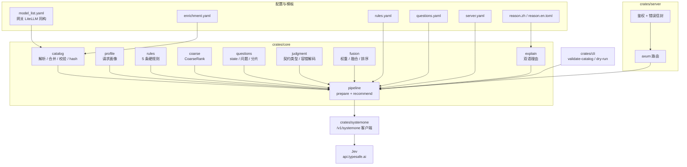
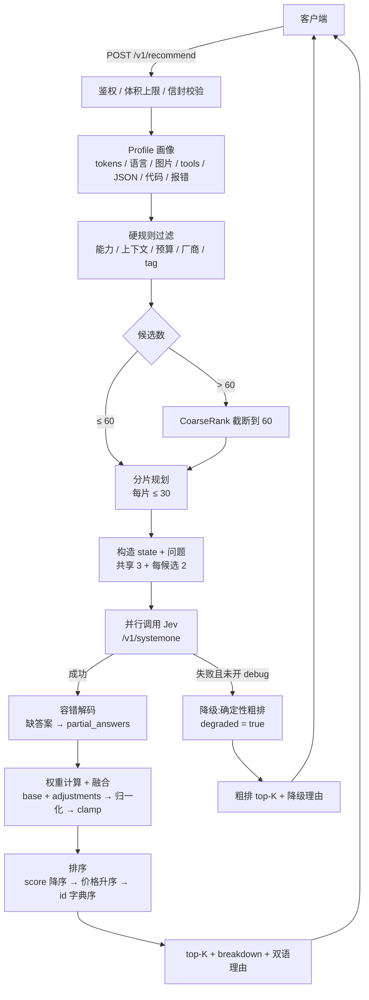
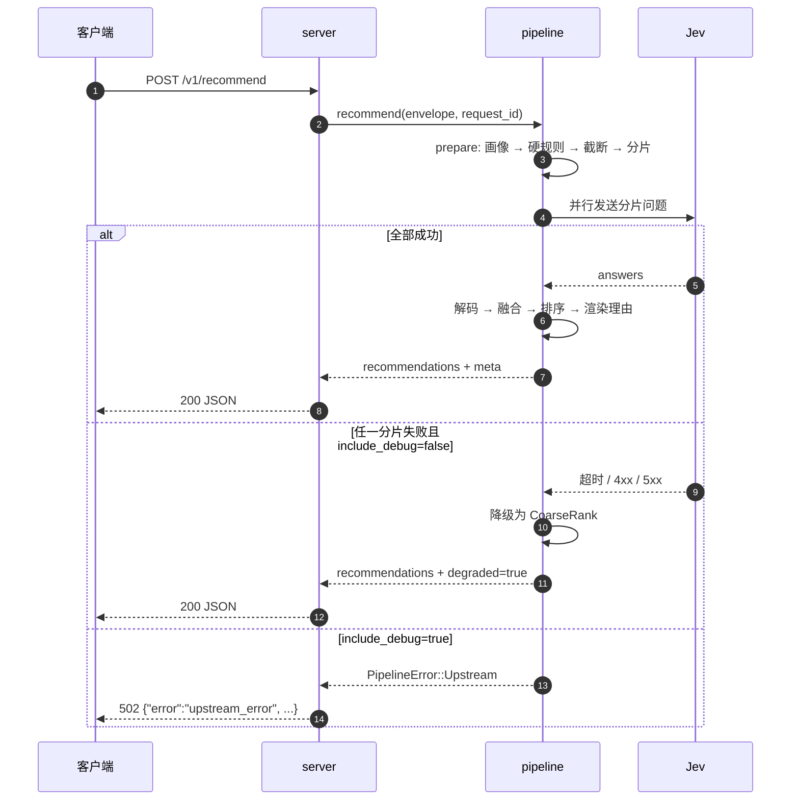

**简体中文** | [English](README.en.md) | [繁體中文](README.zh-TW.md)

# intelligent-model-router(模型推荐服务)

输入网关(OpenAI / Claude 风格)的原始请求体(POST body 的 `request` 字段),输出 top-K 模型推荐与中/英模板理由。
三层组合:代码硬规则过滤 + TypeSafe System One(Jev)语义判断 + 代码加权融合。

- 独立 HTTP 服务:只做推荐,不转发、不代调模型;
- 模型目录直接复用网关的 LiteLLM `model_list` 文件(启动时读取,价格随文件同步;改价/改目录后重启生效);推荐元数据(能力/上下文/标签)由 `enrichment.yaml` 富化,缺省走 defaults;
- 后端不可用时自动降级为确定性粗排(`degraded: true`),服务照常应答;
- 理由为模板渲染(zh/en),不产生额外 LLM 调用。

## 架构与处理流程

### 模块与数据流



### 一次推荐请求



### 调用时序



### 分层说明

1. **目录装配(启动时)**:`catalog.model_list_path` + `catalog.enrichment_path` → 解析 LiteLLM `model_list`,按 `enrichment.yaml` 逐字段富化;同名多部署合并(价格取首条);非 chat / disabled / 缺价格条目进入 `skipped`;内容 hash 前 16 位作为 `catalog_version`。
2. **画像**:从原始请求提取估算 token、CJK 占比(zh/other)、图片、tools 数量、JSON 模式、流式、`max_tokens`、代码块/报错/链接提示,并生成头 2000/尾 500 字符的清洗摘录。
3. **硬规则**:能力(tools/vision/json_mode)、上下文(`ceil(est×safety)+max_tokens ≤ context_window`)、预算、厂商白/黑名单、`require_tags`;首个命中过滤即淘汰该候选。
4. **截断与分片**:候选 > 60 时先按 CoarseRank 截断;每片 ≤ 30 个候选,片内问题 ID 重新编号为 `c0…`,答案再映射回全局下标。
5. **语义判断**:共享问题 `task_type` / `difficulty` / `frontier_needed` + 每候选 `quality_fit` / `cost_fit`;并行调用 `/v1/systemone`(模型由后端配置钉死,如 `jev-1.13.0`)。
6. **容错解码**:缺答案/类型错误的问题进入 `meta.partial_answers`,缺失维度按归一化 0.5、置信度 0 参与融合。
7. **权重与融合**:`base`(默认 0.75/0.25)+ 命中的 `adjustments`(同一调整内所有条件 AND)→ 归一化 → 按 `clamp` 截断;`score = w_q·quality + w_c·cost − penalty`。
8. **排序与输出**:`score` 降序 → 输入价升序 → `id` 字典序;输出 top-K,`breakdown` 带 quality/cost/weights/penalty/rule_hits,理由由 zh/en 模板渲染。
9. **降级**:任一后端分片失败且未开 `include_debug` 时,按 CoarseRank 返回确定性 top-K(`confidence=null`、`breakdown.coarse`、`degraded_reason` 标注原因),服务不 5xx。

### 关键策略

| 策略 | 规则 |
|---|---|
| 粗排 | `0.5×标签重叠率 + 0.5×价格分位`;价格分位按**通过硬规则的候选集**计算(最便宜 1.0,最贵 0.0) |
| 截断 | 候选 > `max_candidates_judged`(60)时按粗排取前 60 |
| 分片 | 每片 ≤ `max_candidates_in_call`(30),并行请求 |
| 权重 | base + adjustments(全条件 AND)→ 归一化 → clamp `[0.05, 0.95]` |
| 融合 | 缺失维度按 0.5 参与,置信度取各维度最小值 |
| 排序 | score 降序 → 价格升序 → id 字典序(完全确定性) |
| 降级 | 后端不可用 → 粗排 top-K,`degraded: true`,HTTP 仍为 200 |
| 可复现 | 全流程无随机数;golden 快照固定 request_id/latency 后逐字节比对 |

### 与网关(如 new-api)的关系

两者互补,不重复:

- **本项目**:根据原始请求回答“**该用哪个模型**”,输出 top-K 推荐与理由;
- **new-api / LiteLLM 等网关**:根据已选定的 `model` 回答“**这个模型走哪个上游渠道**”(priority + weight 负载均衡、失败换渠道重试)。

推荐结果可直接作为下游网关请求的 `model` 字段;M3 计划提供 new-api 旁路/jsplugin 示例。

## 前置条件

- Rust ≥ 1.85(`cargo --version`);curl;
- 以下命令均在仓库根执行(理由模板 `templates_dir` 为 CWD 相对路径);
- 真实调用需要 `TYPESAFE_API_KEY`(写入 `.env`)。无 key/断网时服务仍可启动,请求自动降级。

## 快速开始(本地)

```bash
# 1. 构建
cargo build --release

# 2. 准备 key(仅需真实调用时;.env 已 gitignore,勿提交)
cp .env.example .env      # 然后填入 TYPESAFE_API_KEY

# 3. 校验配置与模型目录(退出码 0 = 通过,2 = 配置错误)
./target/release/recommender-cli validate-catalog --configs configs/

# 4. 离线查看"将发送给 Jev 的完整问题"(不联网)
./target/release/recommender-cli dry-run --configs configs/ --request examples/sample-request.json

# 5. 启动服务(key 只从环境变量读;直连 api.typesafe.ai 若报 451 需代理,见下)
set -a && . ./.env && set +a
./target/release/recommender-server --configs configs/
#   区域限制(451)时改用:HTTPS_PROXY=http://127.0.0.1:7897 ./target/release/recommender-server --configs configs/
#   也可在 configs/server.yaml 的 backends[].proxy 固定代理

# 6. 端到端拿 top5 + 理由(或浏览器打开 http://127.0.0.1:8787/debug)
curl -s http://127.0.0.1:8787/v1/recommend \
     -H 'content-type: application/json' -d @examples/sample-request.json
```

> 无 key / 断网也能跑通:Jev 调用失败时按降级路径返回粗排结果(`degraded: true`)。
> 端口冲突:改 `configs/server.yaml` 的 `server.listen`。
> 若设置了 `RECOMMENDER_AUTH_TOKEN`,上面的 curl 还需加 `-H 'authorization: Bearer <token>'`(见「鉴权」)。

## 生产部署

以下以 Linux + systemd 为例(已验证路径);Docker/Compose 属 M2 计划。

### 1. 构建与安装

```bash
cargo build --release

sudo useradd --system --home /opt/model-recommender --shell /usr/sbin/nologin recommender
sudo mkdir -p /opt/model-recommender
sudo cp target/release/recommender-server target/release/recommender-cli /opt/model-recommender/
sudo cp -r configs templates /opt/model-recommender/
sudo cp .env.example /opt/model-recommender/
sudo chown -R recommender:recommender /opt/model-recommender

# 安装后先体检(退出码 0 才继续)
cd /opt/model-recommender
sudo -u recommender ./recommender-cli validate-catalog --configs configs/
```

> 目录布局必须保持 `configs/` 与 `templates/` 相对 `WorkingDirectory` 存在;两者也可改为绝对路径(`server.yaml` 的 `catalog.*` 与 `templates_dir`)。

### 2. 环境变量

```bash
sudo cp /opt/model-recommender/.env.example /opt/model-recommender/.env
sudo chmod 600 /opt/model-recommender/.env
sudo -e /opt/model-recommender/.env
```

`.env` 内容(systemd `EnvironmentFile` 格式,无需 `export`):

```dotenv
TYPESAFE_API_KEY=sk-...
# 生产建议开启(名字与 configs/server.yaml 的 *_token_env 对应)
RECOMMENDER_AUTH_TOKEN=change-me
RECOMMENDER_ADMIN_TOKEN=change-me-too
# 区域限制需要代理时取消注释
# HTTPS_PROXY=http://127.0.0.1:7897
```

### 3. systemd

```ini
# /etc/systemd/system/model-recommender.service
[Unit]
Description=Model Recommender
After=network-online.target
Wants=network-online.target

[Service]
Type=simple
User=recommender
Group=recommender
WorkingDirectory=/opt/model-recommender
EnvironmentFile=/opt/model-recommender/.env
Environment=RUST_LOG=info
ExecStart=/opt/model-recommender/recommender-server --configs configs/
Restart=on-failure
RestartSec=3
NoNewPrivileges=true
PrivateTmp=true

[Install]
WantedBy=multi-user.target
```

```bash
sudo systemctl daemon-reload
sudo systemctl enable --now model-recommender
sudo systemctl status model-recommender
sudo journalctl -u model-recommender -f
```

### 4. 反向代理与鉴权

服务默认监听 `0.0.0.0:8787`。公网部署建议置于反向代理之后,并**务必设置 token**:

> 同机反向代理会让所有来源都显示为 loopback;未设置 token 时鉴权会放行本机来源。

Caddy:

```caddyfile
recommend.example.com {
    reverse_proxy 127.0.0.1:8787
}
```

Nginx:

```nginx
location / {
    proxy_pass http://127.0.0.1:8787;
    proxy_set_header Host $host;
    proxy_set_header X-Real-IP $remote_addr;
    proxy_read_timeout 60s;
}
```

调用:

```bash
curl -s https://recommend.example.com/v1/recommend \
  -H 'content-type: application/json' \
  -H 'authorization: Bearer change-me' \
  -d @examples/sample-request.json
```

- `/debug` 页面本身对本机豁免;若不希望暴露,设 `debug_page_enabled: false` 或在代理层屏蔽 `/debug`;
- `/v1/catalog` 使用 `RECOMMENDER_ADMIN_TOKEN`。

### 5. 健康检查、日志与升级

```bash
curl -fsS http://127.0.0.1:8787/healthz     # 存活
curl -fsS http://127.0.0.1:8787/readyz      # 就绪(目录非空;不探测 Jev 连通性)
```

- `/readyz` 只检查目录非空;缺 key 时仍为 200,但请求会带 `degraded: true`(启动日志有 warning);
- 日志:systemd → `journalctl -u model-recommender`;容器/前台 → stdout,`RUST_LOG=info|debug`;
- 升级:重新构建 → 覆盖两个二进制 → `validate-catalog` → `systemctl restart model-recommender`(配置在启动时读取,改配置需重启)。

### 6. 排障清单

| 现象 | 排查 |
|---|---|
| `451` / `backend_4xx` | 区域限制:设置 `HTTPS_PROXY` 或 `server.yaml` 的 `backends[].proxy` |
| 全部请求 `degraded: true` | 未配置 `TYPESAFE_API_KEY`(启动日志有 warning),或代理不可达 |
| 启动报模板失败 | `templates_dir` 相对 `WorkingDirectory`;确认 `reason.zh.toml`/`reason.en.toml` 存在 |
| `401 unauthorized` | 已设置 token 但请求未带 `Authorization: Bearer`;或经代理后被当作非本机 |
| `413 request_too_large` | 调大 `server.max_request_bytes`(默认 4 MiB) |
| `422 invalid_constraints` | `top_k` 越界(1–50)或预算/字段类型不合法;错误信封带 `request_id` |

## 指向你的真实网关模型清单

仓库内 `configs/model_list.yaml` 是**脱敏示例**(不含 api_base/api_key/内网主机名)。

1. 把 `configs/server.yaml` 的 `catalog.model_list_path` 改成网关 LiteLLM 配置的绝对路径;
2. 重跑 `./target/release/recommender-cli validate-catalog --configs configs/`,按「排除/依赖默认富化/警告」清单补齐 `configs/enrichment.yaml`(vendor/能力/上下文/标签;模板驱动的理由质量与之正相关);
3. 需要独立维护富化文件时,把 `catalog.enrichment_path` 一并指向你的路径。

## 配置(五份 + 模板)

| 文件 | 作用 |
|---|---|
| `configs/model_list.yaml` | 模型清单(与网关 LiteLLM `model_list` 同构;同名多部署自动合并,价格取首条;示例为脱敏子集) |
| `configs/enrichment.yaml` | 推荐元数据富化(全部可选;字段级覆盖 defaults) |
| `configs/rules.yaml` | 硬规则:能力 / 上下文 / 预算 / 厂商 / tag |
| `configs/questions.yaml` | 提问与语义判断配置(档位、权重、置信度门槛、价格带) |
| `configs/server.yaml` | 监听、鉴权、backends(契约钉死 `jev-1.13.0`)、catalog 路径、请求体/候选限额;缓存/重试/指标为 M2 预留 |
| `templates/reason.{zh,en}.toml` | 理由模板(zh/en) |

## 端点

| 端点 | 说明 |
|---|---|
| `POST /v1/recommend` | 推荐主接口;body `{request, constraints, options}`(内层 `request` 为网关原始请求体) |
| `GET /v1/catalog` | 当前模型目录(admin token;未配置时仅本机可访问) |
| `GET /healthz` | 存活探针 |
| `GET /readyz` | 就绪探针:目录非空即 200,否则 503;不探测 Jev 连通性/密钥(缺 key 时仍 ready,但请求走降级) |
| `GET /debug` | 内嵌调试页(可由 `debug_page_enabled` 关闭) |

## 鉴权

- 配置了 `client_auth_token_env`(默认 `RECOMMENDER_AUTH_TOKEN`)→ `POST /v1/recommend` **必须** `Authorization: Bearer <token>`(本机来源也不例外);
- 未配置该环境变量 → 仅本机(loopback)可访问,非本机 401;
- `GET /debug` 页面本身对本机豁免(页面不含数据;页面里的 fetch 仍需 token);
- `GET /v1/catalog` 使用 `admin_token_env`(默认 `RECOMMENDER_ADMIN_TOKEN`);未配置时仅本机可访问;
- 部署在同机反向代理之后时,所有来源都显示为本机 —— 必须配置 token。

## 数据与隐私

判断请求会发送到 `api.typesafe.ai`:清洗/截断后的请求摘录(`request_excerpt`,头 2000/尾 500 字符)、候选目录元数据与问题定义;判断内容不含 API key(密钥仅用于请求鉴权)。敏感数据场景请使用离线降级路径,或等待 v1.1 的本地 Laya 后端。

## 测试

```bash
cargo test                                          # 单元 + 契约(wiremock)+ 服务 + CLI + golden
cargo test -p recommender-core --test golden_e2e    # golden 全链路(离线夹具回放)
```

Golden 夹具:`eval/fixtures/jev_code_debug.json`(录制/合成与重录步骤见 [`eval/fixtures/README.md`](eval/fixtures/README.md))。

## 目录结构

```
crates/core         # 纯逻辑:画像/规则/提问/融合/理由/pipeline
crates/systemone    # /v1/systemone 契约客户端
crates/server       # axum 服务 + 内嵌 /debug
crates/cli          # validate-catalog / dry-run
configs/            # 五份配置
templates/          # 理由模板(zh/en)
examples/           # 样例请求(sample-request.json)
eval/fixtures/      # golden 夹具
docs/               # 设计文档与实施计划
```

## 范围与路线

- 本版 = 设计文档 §11 的 M0 骨架 + M1 核心;
- M2(另写计划):moka 缓存、完整重试/退避/总预算/信号量、指标与审计日志、`eval` 工具(≥30 golden 场景与指标)、Docker;
- M3(按需):new-api 旁路接入示例、shadow 回放;
- v1.1+:本地 Laya 后端、学习型粗排等见设计文档 §13。

设计文档:[`docs/superpowers/specs/2026-10-16-model-recommender-design.md`](docs/superpowers/specs/2026-10-16-model-recommender-design.md)
实施计划:[`docs/superpowers/plans/2026-10-16-model-recommender-core.md`](docs/superpowers/plans/2026-10-16-model-recommender-core.md)
