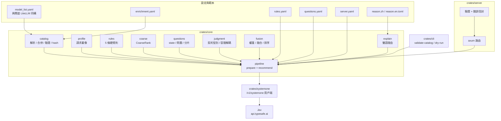
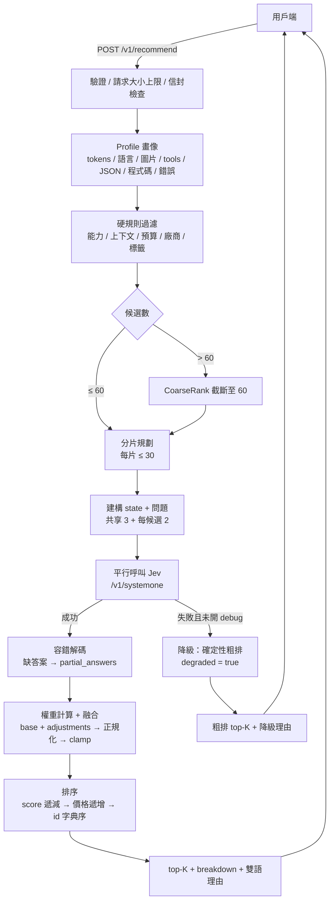
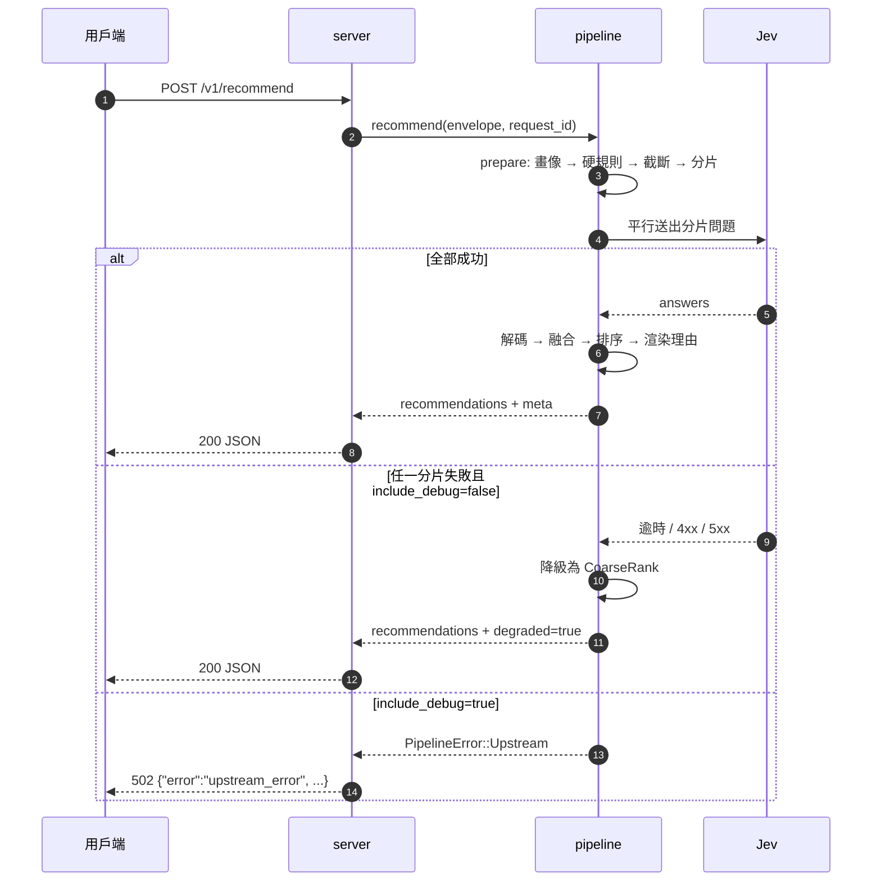

[简体中文](README.md) | [English](README.en.md) | **繁體中文**

# intelligent-model-router(模型推薦服務)

輸入閘道(OpenAI / Claude 風格)的原始請求內容(POST body 的 `request` 欄位),輸出 top-K 模型推薦與中/英範本理由。
三層組合:程式碼硬規則過濾 + TypeSafe System One(Jev)語意判斷 + 程式碼加權融合。

- 獨立 HTTP 服務:只做推薦,不轉發、不代為呼叫模型;
- 模型目錄直接沿用閘道的 LiteLLM `model_list` 檔案(啟動時讀取,價格隨檔案同步;改價/改目錄後重新啟動生效);推薦中繼資料(能力/上下文/標籤)由 `enrichment.yaml` 補充,缺省走 defaults;
- 後端無法使用時自動降級為確定性粗排(`degraded: true`),服務照常回應;
- 理由為範本渲染(zh/en),不產生額外 LLM 呼叫。

## 架構與處理流程

### 模組與資料流



### 一次推薦請求



### 呼叫時序



### 分層說明

1. **目錄組裝(啟動時)**:`catalog.model_list_path` + `catalog.enrichment_path` → 解析 LiteLLM `model_list`,依 `enrichment.yaml` 逐欄位補充;同名多部署合併(價格取第一筆);非 chat / disabled / 缺價格的項目進入 `skipped`;內容 hash 前 16 碼作為 `catalog_version`。
2. **畫像**:從原始請求擷取估算 token、CJK 比例(zh/other)、圖片、tools 數量、JSON 模式、串流、`max_tokens`、程式碼區塊/錯誤/連結提示,並產生前 2000/後 500 字元的清洗摘錄。
3. **硬規則**:能力(tools/vision/json_mode)、上下文(`ceil(est×safety)+max_tokens ≤ context_window`)、預算、廠商白/黑名單、`require_tags`;第一個命中的過濾即淘汰該候選。
4. **截斷與分片**:候選超過 60 時先依 CoarseRank 截斷;每片 ≤ 30 個候選,片內問題 ID 重新編號為 `c0…`,答案再對應回全域索引。
5. **語意判斷**:共享問題 `task_type` / `difficulty` / `frontier_needed` + 每候選 `quality_fit` / `cost_fit`;平行呼叫 `/v1/systemone`(模型由後端設定釘死,例如 `jev-1.13.0`)。
6. **容錯解碼**:缺答案/型別錯誤的問題列入 `meta.partial_answers`,缺少的維度以正規化 0.5、信心度 0 參與融合。
7. **權重與融合**:`base`(預設 0.75/0.25)+ 命中的 `adjustments`(同一調整內所有條件 AND)→ 正規化 → 依 `clamp` 截斷;`score = w_q·quality + w_c·cost − penalty`。
8. **排序與輸出**:`score` 遞減 → 輸入價格遞增 → `id` 字典序;輸出 top-K,`breakdown` 帶 quality/cost/weights/penalty/rule_hits,理由由 zh/en 範本渲染。
9. **降級**:任一分片失敗且未開 `include_debug` 時,依 CoarseRank 回傳確定性 top-K(`confidence=null`、`breakdown.coarse`、`degraded_reason` 標示原因),服務不以 5xx 回應。

### 關鍵策略

| 策略 | 規則 |
|---|---|
| 粗排 | `0.5×標籤重疊率 + 0.5×價格分位`;價格分位以**通過硬規則的候選集**計算(最便宜 1.0,最貴 0.0) |
| 截斷 | 候選 > `max_candidates_judged`(60)時依粗排取前 60 |
| 分片 | 每片 ≤ `max_candidates_in_call`(30),平行請求 |
| 權重 | base + adjustments(全條件 AND)→ 正規化 → clamp `[0.05, 0.95]` |
| 融合 | 缺少的維度以 0.5 參與,信心度取各維度最小值 |
| 排序 | score 遞減 → 價格遞增 → id 字典序(完全確定性) |
| 降級 | 後端無法使用 → 粗排 top-K,`degraded: true`,HTTP 仍為 200 |
| 可重現 | 全流程無隨機數;golden 快照固定 request_id/latency 後逐位元組比對 |

### 與閘道(如 new-api)的關係

兩者互補,不重疊:

- **本專案**:依原始請求回答「**該用哪個模型**」,輸出 top-K 推薦與理由;
- **new-api / LiteLLM 等閘道**:依已選定的 `model` 回答「**這個模型走哪個上游渠道**」(priority + weight 負載平衡、失敗換渠道重試)。

推薦結果可直接作為下游閘道請求的 `model` 欄位;M3 計畫提供 new-api 旁路/jsplugin 範例。

## 前置條件

- Rust ≥ 1.85(`cargo --version`);curl;
- 以下指令均在儲存庫根目錄執行(理由範本 `templates_dir` 為 CWD 相對路徑);
- 真實呼叫需要 `TYPESAFE_API_KEY`(寫入 `.env`)。無 key/斷網時服務仍可啟動,請求自動降級。

## 快速開始(本機)

```bash
# 1. 建置
cargo build --release

# 2. 準備 key(僅真實呼叫時需要;.env 已 gitignore,請勿提交)
cp .env.example .env      # 然後填入 TYPESAFE_API_KEY

# 3. 驗證設定與模型目錄(結束碼 0 = 通過,2 = 設定錯誤)
./target/release/recommender-cli validate-catalog --configs configs/

# 4. 離線檢視「將送給 Jev 的完整問題」(不連網)
./target/release/recommender-cli dry-run --configs configs/ --request examples/sample-request.json

# 5. 啟動服務(key 只從環境變數讀取;直連 api.typesafe.ai 若回 451 需代理,見下)
set -a && . ./.env && set +a
./target/release/recommender-server --configs configs/
#   區域限制(451)時改用:HTTPS_PROXY=http://127.0.0.1:7897 ./target/release/recommender-server --configs configs/
#   也可在 configs/server.yaml 的 backends[].proxy 固定代理

# 6. 端到端取得 top5 + 理由(或瀏覽器開啟 http://127.0.0.1:8787/debug)
curl -s http://127.0.0.1:8787/v1/recommend \
     -H 'content-type: application/json' -d @examples/sample-request.json
```

> 無 key / 斷網也能運作:Jev 呼叫失敗時依降級路徑回傳粗排結果(`degraded: true`)。
> 連接埠衝突:修改 `configs/server.yaml` 的 `server.listen`。
> 若設定了 `RECOMMENDER_AUTH_TOKEN`,上面的 curl 還需加上 `-H 'authorization: Bearer <token>'`(見「驗證」)。

## 生產部署

以下以 Linux + systemd 為例(已驗證路徑);Docker/Compose 屬 M2 計畫。

### 1. 建置與安裝

```bash
cargo build --release

sudo useradd --system --home /opt/model-recommender --shell /usr/sbin/nologin recommender
sudo mkdir -p /opt/model-recommender
sudo cp target/release/recommender-server target/release/recommender-cli /opt/model-recommender/
sudo cp -r configs templates /opt/model-recommender/
sudo cp .env.example /opt/model-recommender/
sudo chown -R recommender:recommender /opt/model-recommender

# 安裝後先檢查(結束碼 0 才繼續)
cd /opt/model-recommender
sudo -u recommender ./recommender-cli validate-catalog --configs configs/
```

> 目錄配置必須讓 `configs/` 與 `templates/` 相對於 `WorkingDirectory` 存在;兩者也可改為絕對路徑(`server.yaml` 的 `catalog.*` 與 `templates_dir`)。

### 2. 環境變數

```bash
sudo cp /opt/model-recommender/.env.example /opt/model-recommender/.env
sudo chmod 600 /opt/model-recommender/.env
sudo -e /opt/model-recommender/.env
```

`.env` 內容(systemd `EnvironmentFile` 格式,無需 `export`):

```dotenv
TYPESAFE_API_KEY=sk-...
# 生產環境建議開啟(名稱需與 configs/server.yaml 的 *_token_env 對應)
RECOMMENDER_AUTH_TOKEN=change-me
RECOMMENDER_ADMIN_TOKEN=change-me-too
# 區域限制需要代理時取消註解
# HTTPS_PROXY=http://127.0.0.1:7897
```

### 3. systemd

```ini
# /etc/systemd/system/model-recommender.service
[Unit]
Description=Model Recommender
After=network-online.target
Wants=network-online.target

[Service]
Type=simple
User=recommender
Group=recommender
WorkingDirectory=/opt/model-recommender
EnvironmentFile=/opt/model-recommender/.env
Environment=RUST_LOG=info
ExecStart=/opt/model-recommender/recommender-server --configs configs/
Restart=on-failure
RestartSec=3
NoNewPrivileges=true
PrivateTmp=true

[Install]
WantedBy=multi-user.target
```

```bash
sudo systemctl daemon-reload
sudo systemctl enable --now model-recommender
sudo systemctl status model-recommender
sudo journalctl -u model-recommender -f
```

### 4. 反向代理與驗證

服務預設監聽 `0.0.0.0:8787`。公網部署建議置於反向代理之後,並**務必設定 token**:

> 同機反向代理會讓所有來源都顯示為 loopback;未設定 token 時,本機來源會被放行。

Caddy:

```caddyfile
recommend.example.com {
    reverse_proxy 127.0.0.1:8787
}
```

Nginx:

```nginx
location / {
    proxy_pass http://127.0.0.1:8787;
    proxy_set_header Host $host;
    proxy_set_header X-Real-IP $remote_addr;
    proxy_read_timeout 60s;
}
```

呼叫:

```bash
curl -s https://recommend.example.com/v1/recommend \
  -H 'content-type: application/json' \
  -H 'authorization: Bearer change-me' \
  -d @examples/sample-request.json
```

- `/debug` 頁面本身對本機豁免;若不希望暴露,設 `debug_page_enabled: false` 或在代理層封鎖 `/debug`;
- `/v1/catalog` 使用 `RECOMMENDER_ADMIN_TOKEN`。

### 5. 健康檢查、日誌與升級

```bash
curl -fsS http://127.0.0.1:8787/healthz     # 存活
curl -fsS http://127.0.0.1:8787/readyz      # 就緒(目錄非空;不探測 Jev 連線)
```

- `/readyz` 只檢查目錄非空;缺 key 時仍為 200,但請求會帶 `degraded: true`(啟動日誌有 warning);
- 日誌:systemd → `journalctl -u model-recommender`;容器/前景 → stdout,`RUST_LOG=info|debug`;
- 升級:重新建置 → 覆蓋兩個執行檔 → `validate-catalog` → `systemctl restart model-recommender`(設定於啟動時讀取,改設定需重新啟動)。

### 6. 疑難排解

| 現象 | 排查 |
|---|---|
| `451` / `backend_4xx` | 區域限制:設定 `HTTPS_PROXY` 或 `server.yaml` 的 `backends[].proxy` |
| 所有請求都是 `degraded: true` | 未設定 `TYPESAFE_API_KEY`(啟動日誌有 warning),或代理無法連線 |
| 啟動時範本載入失敗 | `templates_dir` 相對於 `WorkingDirectory`;確認 `reason.zh.toml`/`reason.en.toml` 存在 |
| `401 unauthorized` | 已設定 token 但請求未帶 `Authorization: Bearer`;或經代理後被視為非本機 |
| `413 request_too_large` | 調大 `server.max_request_bytes`(預設 4 MiB) |
| `422 invalid_constraints` | `top_k` 超出範圍(1–50)或預算/欄位型別不合法;錯誤信封帶 `request_id` |

## 指向你的真實閘道模型清單

儲存庫內的 `configs/model_list.yaml` 是**去識別化範例**(不含 api_base/api_key/內網主機名稱)。

1. 把 `configs/server.yaml` 的 `catalog.model_list_path` 改成閘道 LiteLLM 設定的絕對路徑;
2. 重新執行 `./target/release/recommender-cli validate-catalog --configs configs/`,依「排除/依賴預設補充/警告」清單補齊 `configs/enrichment.yaml`(vendor/能力/上下文/標籤;範本驅動的理由品質與之正相關);
3. 需要獨立維護補充檔時,把 `catalog.enrichment_path` 一併指向你的路徑。

## 設定(五份 + 範本)

| 檔案 | 作用 |
|---|---|
| `configs/model_list.yaml` | 模型清單(與閘道 LiteLLM `model_list` 同構;同名多部署自動合併,價格取第一筆;範例為去識別化子集) |
| `configs/enrichment.yaml` | 推薦中繼資料補充(全部可選;欄位級覆蓋 defaults) |
| `configs/rules.yaml` | 硬規則:能力 / 上下文 / 預算 / 廠商 / 標籤 |
| `configs/questions.yaml` | 提問與語意判斷設定(檔位、權重、信心度門檻、價格帶) |
| `configs/server.yaml` | 監聽、驗證、backends(契約釘死 `jev-1.13.0`)、catalog 路徑、請求大小/候選上限;快取/重試/指標為 M2 預留 |
| `templates/reason.{zh,en}.toml` | 理由範本(zh/en) |

## 端點

| 端點 | 說明 |
|---|---|
| `POST /v1/recommend` | 推薦主介面;body `{request, constraints, options}`(內層 `request` 為閘道原始請求內容) |
| `GET /v1/catalog` | 目前模型目錄(admin token;未設定時僅本機可存取) |
| `GET /healthz` | 存活探針 |
| `GET /readyz` | 就緒探針:目錄非空即 200,否則 503;不探測 Jev 連線/金鑰(缺 key 時仍 ready,但請求走降級) |
| `GET /debug` | 內嵌除錯頁(可由 `debug_page_enabled` 關閉) |

## 驗證

- 設定了 `client_auth_token_env`(預設 `RECOMMENDER_AUTH_TOKEN`)→ `POST /v1/recommend` **必須**帶 `Authorization: Bearer <token>`(本機來源也不例外);
- 未設定該環境變數 → 僅本機(loopback)可存取,非本機回 401;
- `GET /debug` 頁面本身對本機豁免(頁面不含資料;頁面內的 fetch 仍需 token);
- `GET /v1/catalog` 使用 `admin_token_env`(預設 `RECOMMENDER_ADMIN_TOKEN`);未設定時僅本機可存取;
- 部署在同機反向代理之後時,所有來源都顯示為本機 —— 必須設定 token。

## 資料與隱私

判斷請求會送到 `api.typesafe.ai`:清洗/截斷後的請求摘錄(`request_excerpt`,前 2000/後 500 字元)、候選目錄中繼資料與問題定義;判斷內容不含 API key(金鑰僅用於請求驗證)。敏感資料場景請使用離線降級路徑,或等待 v1.1 的本機 Laya 後端。

## 測試

```bash
cargo test                                          # 單元 + 契約(wiremock)+ 服務 + CLI + golden
cargo test -p recommender-core --test golden_e2e    # golden 全鏈路(離線測試資料回放)
```

Golden 測試資料:`eval/fixtures/jev_code_debug.json`(錄製/合成與重錄步驟見 [`eval/fixtures/README.md`](eval/fixtures/README.md))。

## 目錄結構

```
crates/core         # 純邏輯:畫像/規則/提問/融合/理由/pipeline
crates/systemone    # /v1/systemone 契約用戶端
crates/server       # axum 服務 + 內嵌 /debug
crates/cli          # validate-catalog / dry-run
configs/            # 五份設定
templates/          # 理由範本(zh/en)
examples/           # 範例請求(sample-request.json)
eval/fixtures/      # golden 測試資料
docs/               # 設計文件與實作計畫
```

## 範圍與路線

- 本版 = 設計文件 §11 的 M0 骨架 + M1 核心;
- M2(另寫計畫):moka 快取、完整重試/退避/總預算/號誌量、指標與稽核日誌、`eval` 工具(≥30 golden 場景與指標)、Docker;
- M3(視需求):new-api 旁路範例、shadow 回放;
- v1.1+:本機 Laya 後端、學習型粗排等見設計文件 §13。

設計文件:[`docs/superpowers/specs/2026-10-16-model-recommender-design.md`](docs/superpowers/specs/2026-10-16-model-recommender-design.md)
實作計畫:[`docs/superpowers/plans/2026-10-16-model-recommender-core.md`](docs/superpowers/plans/2026-10-16-model-recommender-core.md)
